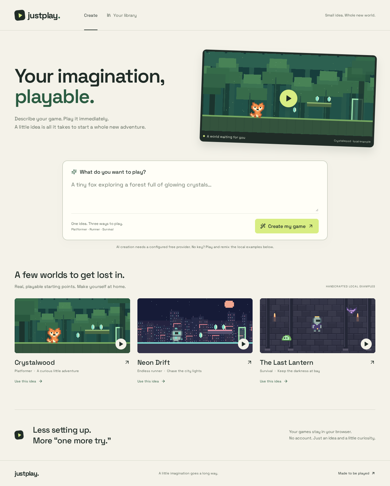

# JustPlay

Describe your game in a few words and AI generates a professional 2D game in seconds.

**Describe your game. Play it immediately.** An original browser game studio with three playable Phaser families, validated AI designs, conversational revisions and a local library. Generation speed and visual quality depend on the provider and the constrained design space; no credentials are required to play the labeled local examples.



## What works

- **Crystalwood**: a fox platformer with crystals, patrol enemies, double jump and a forest gate.
- **Neon Drift**: an accelerating rooftop runner with obstacles and a distance objective.
- **The Last Lantern**: top-down survival with chasing enemies, health and automatic projectiles.
- Three original pixel worlds, animated local sprites, parallax, particles, sound opt-in, keyboard/touch input, pause/restart/fullscreen and win/loss states.
- Strict Zod GameSpec pipeline; separate Groq and Gemini/Gemma 4 adapters; server-only credentials, request bounds, timeout/repair/quota errors and a Cloudflare rate-limit binding.
- Studio edits, immutable version history, IndexedDB saves/reopen/delete, JSON export/import.

**No live AI or deployment is claimed.** The task environment supplied no keys. Authored local examples and their four deterministic edit suggestions are explicitly labeled; arbitrary prompts use the real server proxy and fail honestly if it is not configured.

## Run in a development/cloud workspace

```sh
npm ci
npm run dev
```

This opens the frontend on port 5173. For the complete local server, use `npm run dev:full`; `.dev.vars` may hold secure server bindings and is ignored by git. Use only eligible free provider projects with billing disabled. [Deployment](docs/DEPLOYMENT.md) includes mobile-friendly dashboard steps. Never expose keys in `VITE_` variables.

```sh
npm run typecheck
npm run lint
npm test
npx playwright install chromium
npm run test:e2e
npm run deploy:check
```

## Controls

Focus the game with **Play**. Move with **WASD/arrows**, jump with **Space** (double tap for double jump), dash with **Shift** when enabled, **J** to fire in side-view games with shooting. Survival auto-aims/fires. Mobile has direct touch buttons. **Tab** leaves the canvas; text editing does not capture game keys. Sound starts muted. Gold crystals restore health.

## Project notes

[Plan](docs/PLAN.md) · [Research](docs/INSTAPLAY_RESEARCH.md) · [Investigation limits](docs/REVERSE_ENGINEERING.md) · [Graphics](docs/GRAPHICS_ANALYSIS.md) · [Architecture](docs/ARCHITECTURE.md) · [AI pipeline & model evidence](docs/AI_PIPELINE.md) · [Asset licenses](docs/ASSET_LICENSES.md) · [Test results](docs/TEST_RESULTS.md) · [Known limits](docs/KNOWN_LIMITATIONS.md)

[PRODUCT.md](PRODUCT.md) and [DESIGN.md](DESIGN.md) define the product and visual system. Original code/art use the preserved MIT [LICENSE](LICENSE); Space Grotesk uses its included OFL.
